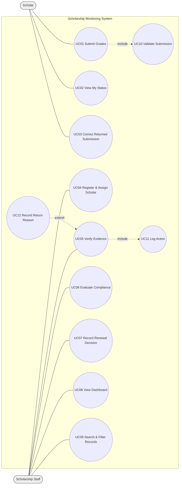

# Part I — Analysis and Design: Scholarship Monitoring and Academic Compliance System
## A1. Investigation and planning

**Problem statement.** The Scholarship Office manages Merit and Community Scholar renewals through spreadsheets, email attachments and paper grade records. This causes duplicate semester entries, unverified grades, missed deadlines and inconsistent decisions, and scholars cannot see whether their submission was received, verified or returned. A browser-based system with Scholar and Staff roles is needed.

| # | Problem | Cause | Effect |
|---|---|---|---|
| 1 | Duplicate semester entries | Multiple uncontrolled spreadsheets/emails | Conflicting records, rework |
| 2 | Unverified grades | No verification step or status | Decisions on unchecked evidence |
| 3 | Missed deadlines | No timestamp or deadline rule | Late records accepted/rejected inconsistently |
| 4 | Inconsistent decisions & no visibility | Policy applied manually; no status feedback | Delayed renewals, scholar uncertainty |

**Scope.** *In:* login with two roles; scholar registration and program assignment; semester submission; verification/return/resubmission; policy-based compliance evaluation; renewal decision; dashboard, search, filter; audit history. *Excluded:* live Registrar API, SMS, ML, payments, appeals, policy exceptions, altering official grades.

**Development tasks.** (1) Schema, policies, RLS. (2) Submission with validation. (3) Verification workflow. (4) Compliance, renewal, dashboard, tests.

| Risk | Response |
|---|---|
| Time overrun in 150 min | Build mandatory path first; styling last |
| Network/hosting failure | Local runnable copy with run instructions |

## A2. Stakeholders and elicitation

| Stakeholder | Actual actor? |
|---|---|
| Scholar | Yes |
| Scholarship Staff | Yes |
| Registrar | No (external source of official grades) |
| Scholarship Office head / auditors | No (consume reports/decisions) |

Elicitation questions:
1. How do you currently decide whether grade evidence is acceptable, and who may verify it?
2. What happens today when a submission arrives after the deadline?
3. Which situations lead you to hold or approve renewal, and who has final say?
4. How should policy exceptions be treated, and who approves them?
5. Who should be able to see a scholar's records, and what must scholars not see or change?
6. Which reports or counts do you need each semester, and how often?

## A3. Requirements and business rules

**Functional**
- FR01 Users sign in; role (Scholar/Staff) determines available functions.
- FR02 A Scholar can view only their own submissions; Staff can view all (enforced by DB RLS).
- FR03 Staff can register a scholar and assign one persisted program policy.
- FR04 A Scholar can submit year, semester, GWA, units, failed/INC/dropped counts and grade-document reference; timestamp is recorded.
- FR05 System rejects GWA outside 1.00–5.00, negative/non-integer counts and a blank evidence reference.
- FR06 System rejects a second submission for the same scholar, year and semester.
- FR07 Staff mark a submission Verified or Returned (reason required for Returned).
- FR08 A Scholar can correct and resubmit a Returned record; status returns to Pending.
- FR09 Staff can evaluate only Verified submissions; result is Compliant/With Deficiency with specific reasons read from the program record.
- FR10 Staff record Approved/Held renewal with a note; Approved requires Compliant.
- FR11 Dashboard shows assigned scholars, pending, compliant, with deficiency for the semester; search by ID/name; filter by program/compliance.
- FR12 Verification, evaluation, renewal and resubmission are logged with actor and timestamp.

**Non-functional**
- NFR01 Dashboard and list load in ≤3 s for 100 records.
- NFR02 100% of write operations execute through role-checked backend functions; direct table writes are denied.
- NFR03 Data persists across refresh (0 lost records).
- NFR04 Every rejected input shows a message naming the failed rule.

**Business rules**
- BR01 Scholars access only own records; only Staff verify, evaluate, decide.
- BR02 Evaluation requires Verified evidence; missing/unverified evidence blocks evaluation.
- BR03 Policy thresholds come from the assigned program (Merit: GWA≤1.75, ≥18 units, 0 F/INC/D; Community: GWA≤2.25, ≥15 units, F 0, INC 0, D≤1). Deadline 2026-10-30 17:00 Asia/Manila; exact deadline is on time.
- BR04 One submission per scholar per academic year and semester.
- BR05 Late submission or any failed condition gives With Deficiency; it does not auto-disqualify. Submission status, compliance and award status are separate.
- BR06 Only Staff decide renewal; Approved needs Compliant; the app never alters official grades or pays.

## A4. UML use case diagram



- **include UC01→UC10:** validation (GWA range, counts, evidence, duplicate) is mandatory in every submission and resubmission. **include UC05→UC11:** every verification must be logged (audit requirement).
- **extend UC12→UC05:** reason capture happens only when staff choose Returned (extension point: "Returned").
- Authentication is a precondition for all use cases. Evaluation and renewal also log via the same function but are not drawn to avoid padding.

## A5. Detailed use cases

**UC01 Submit Grades** — Actor: Scholar. Trigger: Scholar opens submission form. Pre: signed in, assigned to a program. Linked: FR04–FR06, BR04.
Main flow: 1 Scholar picks year and semester. 2 Enters GWA, units, F/INC/D counts. 3 Enters grade-document reference. 4 Submits. 5 System validates (UC10). 6 System stores record with timestamp, status Pending, compliance Not Evaluated. 7 System shows confirmation.
Alt A: record exists with status Returned → system updates it, resets to Pending, logs resubmission. Exceptions: E1 invalid GWA/count → rejected with message; E2 duplicate semester not Returned → "Duplicate" message; E3 blank evidence → rejected.
Post: one submission exists for the scholar-term, Pending verification.

**UC06 Evaluate Compliance** — Actor: Staff. Trigger: staff selects Evaluate on a record. Pre: signed in as Staff; submission Verified; scholar has a program. Linked: FR09, BR02, BR03, BR05.
Main flow: 1 Staff selects record. 2 System checks status = Verified. 3 System loads thresholds from the assigned program record. 4 Compares GWA, units, failed, INC, dropped. 5 Compares timestamp to deadline. 6 Collects a reason per failed check. 7 Sets Compliant (no reasons) or With Deficiency. 8 Logs actor/time; displays reasons.
Alt: Re-evaluation overwrites previous result and resets any renewal decision to None. Exceptions: E1 not Verified → blocked with message; E2 no program assigned → blocked.
Post: compliance result and reasons stored; award status unchanged.

**ERD**

```mermaid
erDiagram
  PROFILES ||--o| ASSIGNMENTS : "assigned (1:0..1)"
  PROGRAMS ||--o{ ASSIGNMENTS : "governs (1:N)"
  PROFILES ||--o{ SUBMISSIONS : "submits (1:N)"
  SUBMISSIONS ||--o{ AUDIT_LOG : "has history (1:N)"
  PROFILES ||--o{ AUDIT_LOG : "acts (1:N)"
  PROFILES { uuid id PK
    uuid auth_id UK
    text student_id UK
    text full_name
    text role }
  PROGRAMS { int id PK
    text name UK
    numeric max_gwa
    int min_units
    int max_failed
    int max_inc
    int max_drop
    timestamptz deadline }
  ASSIGNMENTS { int id PK
    uuid scholar_id FK_UK
    int program_id FK }
  SUBMISSIONS { uuid id PK
    uuid scholar_id FK
    text academic_year
    int semester
    numeric gwa
    int units
    int failed_count
    int inc_count
    int dropped_count
    text evidence_ref
    timestamptz submitted_at
    text verification_status
    text compliance_result
    text renewal_decision }
  AUDIT_LOG { bigint id PK
    uuid submission_id FK
    uuid actor_id FK
    text action
    text detail
    timestamptz at }
```
Unique key on SUBMISSIONS: (scholar_id, academic_year, semester).

## A6. Traceability

| FR | Actor | Use case | BR | Implemented in | Test → expected |
|---|---|---|---|---|---|
| FR06 | Scholar | UC01 | BR04 | `submit_grades()` + unique constraint | TC07 → duplicate rejected with message |
| FR09 | Staff | UC06 | BR02,BR03 | `evaluate_submission()` | TC02 → A02 With Deficiency (GWA) |
| FR10 | Staff | UC07 | BR05,BR06 | `decide_renewal()` | TC10 → approve compliant OK; deficient approval refused |
| FR02 | Scholar | UC02 | BR01 | RLS policies on submissions | TC08 → other scholar's row not returned; verify denied |

Planned but not implemented: policy exceptions, appeals, Registrar integration, payment (explicitly out of scope). Editing policy thresholds through the UI is not built (thresholds are editable table records).
