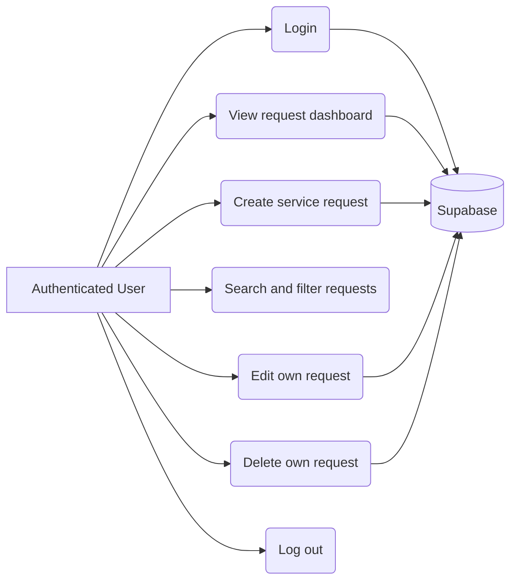
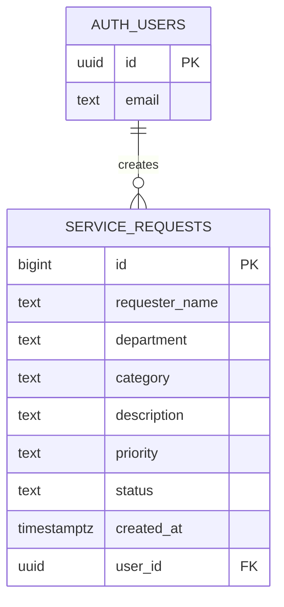

# ICT Service Request Management System

> Replace all values in square brackets and add the screenshots before submitting.

| Submission detail | Value |
| --- | --- |
| Student | [Your full name] |
| Section | [Your section] |
| GitHub Repository | `https://github.com/[username]/SAD-ServiceRequest-Granada/` |
| Live System | `https://[username].github.io/SAD-ServiceRequest-Granada/` |
| Test Account | `[student@test.com]` |

## Problem Statement

ICT concerns such as computer repairs, software installation, network failures, printer problems, and account-access issues are often reported informally. This makes requests difficult to track, prioritize, update, and resolve. The ICT Service Request Management System provides one web-based place where authenticated users can create and manage service requests, while presenting the current request workload in an easy-to-read dashboard.

## Objectives

- Record complete ICT service request details in a centralized database.
- Allow authenticated users to create, view, update, and delete their own requests.
- Help users find requests through keyword, status, and priority filters.
- Show total, pending, in-progress, and completed request counts.

## Scope and Features

- Email-and-password authentication through Supabase Auth.
- Create requests with requester name, department, category, description, priority, and status.
- View requests in a list ordered newest first.
- Edit and delete the requests owned by the current user.
- Search by requester, department, category, or description.
- Filter by request status and priority.
- Dashboard summary cards for request statuses.

## Use Case Diagram



## Entity-Relationship Diagram



`SERVICE_REQUESTS.user_id` references `auth.users.id`. Row-level security allows authenticated users to view requests, but limits insert, update, and delete actions to records owned by the current user.

## Requirements Traceability Matrix

| ID | Requirement | Implementation | Verification result |
| --- | --- | --- | --- |
| FR-01 | Users must log in before opening the dashboard. | `js/auth.js` checks the Supabase session and redirects unauthenticated visitors to `login.html`. | Pass |
| FR-02 | Users must create a request with complete required details. | Request form in `index.html`; `saveRequest()` inserts data into `service_requests`. | Pass |
| FR-03 | Users must view service requests and their details. | `loadRequests()` retrieves and renders requests in the dashboard table. | Pass |
| FR-04 | Users must update their own requests. | Edit modal and Supabase update query; ownership policy in `sql/database.sql`. | Pass |
| FR-05 | Users must delete their own requests. | Delete confirmation and Supabase delete query; ownership policy in `sql/database.sql`. | Pass |
| FR-06 | Users must search and filter requests. | `filterData()` filters by keyword, status, and priority. | Pass |
| FR-07 | Users must see request status totals. | `updateDashboard()` calculates total, pending, in-progress, and completed counts. | Pass |
| NFR-01 | Request data must be protected from unauthorized modification. | Supabase Auth plus row-level-security policies. | Pass |
| NFR-02 | The interface must be usable on different screen sizes. | Responsive viewport configuration and CSS layout. | Pass |

## Testing Results

| Test ID | Test scenario | Expected result | Result |
| --- | --- | --- | --- |
| TC-01 | Submit valid login credentials. | User is redirected to the dashboard. | Pass |
| TC-02 | Open the dashboard without an active session. | User is redirected to the login page. | Pass |
| TC-03 | Submit a request with all required fields. | A new request is saved and appears in the table. | Pass |
| TC-04 | Submit a request with a blank required field. | Browser validation prevents submission. | Pass |
| TC-05 | Edit an existing request. | Changes are saved and displayed after refresh. | Pass |
| TC-06 | Delete an existing request and confirm the prompt. | Request is removed from the table and database. | Pass |
| TC-07 | Search for a requester or issue keyword. | Only matching requests are displayed. | Pass |
| TC-08 | Apply status and priority filters. | Only requests matching both selected filters are displayed. | Pass |
| TC-09 | Check dashboard cards after request changes. | Counts reflect the current request statuses. | Pass |
| TC-10 | Attempt to update or delete another user's request. | Supabase row-level security rejects the action. | Pass |

## Screenshots

Create a `screenshots/` folder and replace the placeholders below with actual images after testing the deployed system.

| Screen | Evidence to include |
| --- | --- |
| Login | `screenshots/login-page.png` — login form |
| Dashboard | `screenshots/dashboard.png` — request table and summary cards |
| New Request | `screenshots/new-request.png` — completed request form |
| Search and Filters | `screenshots/filters.png` — filtered results |
| Edit/Delete | `screenshots/edit-delete.png` — edit form or delete confirmation |

Example Markdown after adding images:

```md

```

## Setup and Deployment

1. Create a Supabase project and run [`sql/database.sql`](sql/database.sql) in its SQL Editor.
2. Enable Email authentication in Supabase Auth and create a test user.
3. Update `SUPABASE_URL` and `SUPABASE_KEY` in [`js/supabase.js`](js/supabase.js) with the project's publishable credentials.
4. Run the site with a local static server for testing.
5. Push the repository to GitHub.
6. In GitHub, open **Settings → Pages**, select **Deploy from a branch**, choose `main` and `/ (root)`, then save. Copy the generated GitHub Pages URL into the submission table above.

## Project Structure

```text
├── index.html          # Authenticated request dashboard
├── login.html          # Login page
├── css/style.css       # Application styles
├── js/auth.js          # Session, login, and logout logic
├── js/app.js           # Request CRUD, filters, and dashboard logic
├── js/supabase.js      # Supabase client configuration
└── sql/database.sql    # Database table and RLS policies
```

## Technologies Used

- HTML5, CSS3, and JavaScript
- Supabase Auth and PostgreSQL database
- GitHub and GitHub Pages
